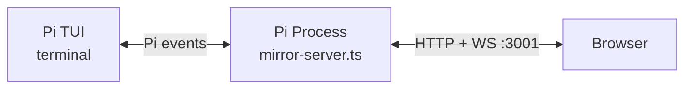

# AGENTS.md

## Policies & Mandatory Rules

### `latestCtx` — Never capture `ctx` in long-lived closures

The Pi extension runner **invalidates** `ExtensionContext` after session replacement, fork, switch, or reload. Any closure that captures a `ctx` parameter and uses it after one of those operations will throw:

> This extension ctx is stale after session replacement or reload. Do not use a captured pi or command ctx after ctx.newSession(), ctx.fork(), ctx.switchSession(), or ctx.reload().

**Rule**: `extensions/mirror-server.ts` uses a module-level `latestCtx` variable. Every Pi event callback updates it with the fresh `ctx`.

**All code that may run after a session lifecycle event** — WebSocket `close`/`error`/`connection` handlers, `setInterval` timers, async callbacks from external sources — must use `latestCtx`, never a captured `ctx` parameter.

The same stale-context rule applies to `latestExecuteCtx` (`ExtensionCommandContext`, captured via `/webui`, adds `navigateTree()`, `fork()`, and other session-control methods).
After session replacement, any captured `ExtensionCommandContext` becomes stale and must be re-captured via `/webui`.

### Extension output — `ctx.ui.setStatus` / `ctx.ui.notify` only

Per `docs/adr/0001-pi-extension-output-policy.md`: never write to `stdout`/`stderr` from extension code. Use `ctx.ui.setStatus(...)` for persistent state and `ctx.ui.notify(...)` for one-shot user messages. Use `latestCtx`, not a captured `ctx`.

### Event forwarding — thin transport

Per `docs/adr/0002-web-ui-extension-event-protocol.md`: Mirror Server forwards events unchanged. Never interpret extension payloads into Pi Web UI product concepts inside the extension. The browser owns feature interpretation.

### Interactive Agent UI positioning

Per `docs/adr/0012-interactive-agent-ui-positioning.md`: Pi Web UI is an **Interactive Agent UI** built to steer high-impulse, cryptic coding models (e.g., GPT coding variants, DeepSeek) that tend to interpret prompts overly literally, diverge into rabbit holes, or rush into execution before clarifying intent. When designing or implementing UI features (such as `Add to Chat`, `Git Diff Comment`, `BTW / Ask in Side Chat`, `AskUserQuestion`, `Edit Message`, or `Generative UI`), keep session scope single-process (`docs/adr/0006-project-scope-single-session-web-ui.md`) and keep product-level UI interpretation in `src/web/` (`docs/adr/0002-web-ui-extension-event-protocol.md`).

### Product language

**Rule**: All UI text is English.

### Explicit Web UI activation

Per `docs/adr/0013-explicit-webui-session-activation.md`: before `/webui`, do not
start servers, register Web UI agent tools, or change existing tools, model
instructions, or conversation context. After activation, Web UI owns its
interactive features; use `webui_ask_user_question` and disable explicitly known
conflict names (`ask_user_question`). Stop and session lifecycle changes clean
up resources and restore affected tool activation without rolling back history
or LLM context. New, switched, or forked sessions and `/reload` require explicit
activation again. Recommend continuing activated sessions in Web UI.

## Domain Language

- **Interactive Agent UI** — Browser interface designed to interrogate, clarify, and steer high-agency coding models rather than passively mirroring terminal text.
- **Add to Chat** — Transcript selection attachment that pins user feedback to exact assistant prose, reasoning, or tool output spans.
- **Git Diff Comment** — Line-level comment/quote action inside the Right Panel Git Diff view (Codex-style) that attaches specific file/line changes and user feedback to the chat composer.
- **Side Chat (BTW)** — Isolated side inquiry in the Right Panel used to unpack cryptic model output without polluting the main session trajectory or triggering main-agent execution.
- **AskUserQuestion** — Structured clarification interaction where the agent presents multi-choice or form questions to align on intent before executing tasks.
- **Edit Message** — Inline editing of a previous user message (`Save & Send`) that rewinds the session via `navigate_tree` and re-sends the updated prompt.
- **Generative UI** — Task-specific interactive visual views rendered in place of dense prose explanations.
- **Process Group** — A collapsible transcript section for a contiguous sequence of assistant reasoning and tool calls within a turn.
- **Row** — A transcript line representing one reasoning block or tool call, with expandable details when available.

## Project Structure Guide

### Repo Structure & Important Files

```
.
├── docs/
│   ├── adr/                     # Architecture Decision Records (必读)
│   │   ├── 0001-pi-extension-output-policy.md          # Extension output rules (no stdout/stderr)
│   │   ├── 0002-web-ui-extension-event-protocol.md     # Web UI event forwarding protocol
│   │   ├── 0003-navigate-tree-via-captured-command-context.md # latestCtx vs latestExecuteCtx workaround
│   │   ├── 0004-web-ui-access-bind-address.md          # Server bind address policy
│   │   ├── 0005-intercepted-command-ui-lifecycle.md    # Intercepted command UI state handling
│   │   ├── 0006-project-scope-single-session-web-ui.md # Single-session scope definition
│   │   ├── 0007-npm-publish-distribution-strategy.md   # npm publish + dist/ strategy
│   │   ├── 0008-unified-websocket-protocol.md          # WebSocket req/res/event protocol
│   │   ├── 0009-frontend-state-management-hybrid-zustand.md # Zustand + local state hybrid
│   │   ├── 0010-real-pi-web-ui-e2e.md                  # Real Pi agent Web UI E2E tests
│   │   ├── 0011-web-ui-visual-validation.md            # Browser screenshot visual validation
│   │   ├── 0012-interactive-agent-ui-positioning.md    # Interactive Agent UI positioning & feature cuts
│   │   ├── 0013-explicit-webui-session-activation.md   # Activation boundary before/after /webui
│   │   └── 0014-web-ui-test-storyboard.md              # Storyboard previews for web E2E scenarios (local)
│   ├── prd/                     # Product Requirement Documents (功能设计)
│   │   ├── columns-layout.md        # Single-column default + on-demand two-column layout
│   │   ├── edit-message.md          # Inline edit user message + Save & Send
│   │   └── right-panel.md           # Right panel (Git Diff + line Comment, Side Chat)
│   ├── configuration.md         # Environment variables, settings.json, and security reference
│   └── images/                  # Screenshots for README
├── extensions/
│   ├── mirror-server.ts         # Main extension: HTTP + WS server + all event handling
│   └── imessage-bridge.ts       # iMessage integration extension
├── e2e/                         # Real Pi agent E2E tests
│   ├── features/                # Playwright-BDD feature files
│   ├── steps/                   # Step definitions
│   ├── fixtures/                # Faux provider extension and response fixtures
│   └── harness/                 # pi --mode rpc process/session launcher
├── src/web/                     # React frontend source
│   ├── index.html               # Vite entry HTML
│   ├── index.css                # Global styles (Tailwind)
│   ├── src/
│   │   ├── main.tsx             # React entry point
│   │   ├── app.tsx              # Root layout + local UI state
│   │   ├── core/
│   │   │   ├── pi-client.ts     # WebSocket transport, reconnect, req/res queue
│   │   │   ├── ws.ts            # WebSocket URL helper
│   │   │   ├── types.ts         # TypeScript types for WebSocket protocol
│   │   │   ├── chat-conversion.ts # Converts raw events → UI message models
│   │   │   ├── format.ts        # Display formatting utilities
│   │   │   ├── workspace-artifacts.ts # Markdown artifact recovery from tool events/session entries
│   │   │   ├── tool-summary.ts  # Tool call summary rendering
│   │   │   ├── constants.ts     # Shared constants
│   │   │   └── store/           # Zustand slices + event dispatcher
│   │   └── components/
│   │       ├── pi-web-ui/       # Pi Web UI components
│   │       │   ├── chat-item-view.tsx    # Main chat message renderer
│   │       │   ├── conversation-sidebar.tsx     # Session tree sidebar
│   │       │   ├── conversation-sidebar-tree.tsx # Tree view component
│   │       │   ├── command-palette.tsx   # Command palette
│   │       │   ├── model-picker.tsx
│   │       │   ├── settings-panel.tsx
│   │       │   ├── context-popover.tsx
│   │       │   ├── right-panel.tsx
│   │       │   ├── workspace-status-float.tsx
│   │       │   ├── user-message-view.tsx # User message with Branch button
│   │       │   └── ...
│   ├── components/
│   │   ├── ai-elements/         # AI Elements components (conversation, message, tool, reasoning, etc.)
│   │   └── ui/                  # shadcn/ui primitives (button, dialog, input, etc.)
│   └── lib/
│       └── utils.ts             # shadcn/ui utility (cn helper)
├── public/                      # Static assets copied by Vite (icons, manifest, sw.js)
├── dist/                        # Vite build output (gitignored)

├── MOBILE.md                    # Mobile access guide
├── RELEASING.md                 # npm publish and pi.dev verification checklist

├── package.json                 # npm package config + pi extension manifest
├── tsconfig.json                # TypeScript config (only src/web + vite.config.ts)
├── vite.config.ts               # Vite config (dev proxy to :3001, build to dist/)
├── biome.json                   # Biome formatter/linter config
└── justfile                     # just tasks (fmt, check)
```

### Architecture: Extension ↔ Frontend Communication



- **Extension (`mirror-server.ts`)**: subscribes to Pi events via `pi.on(...)`, forwards them to browser WebSocket clients. Accepts commands from browser, executes via extension API.
- **Frontend (`src/web/`)**: React + Vite + Tailwind. `PiClient` connects to the extension WebSocket, `event-dispatch.ts` routes raw events into Zustand slices, and React components render store state.
- **Dev proxy**: `vite dev` on `:4444` proxies `/api` → `:3001` and `/ws` → `ws://localhost:3001`.

#### Event envelope

All WebSocket messages to the browser use:

```json
{ "type": "event", "event": "<event-name>", "payload": { "...": "..." } }
```

Pi core events carry their native fields inside `payload`. Extension-bus events keep their source payload nested under `payload` when needed to avoid field collisions.

#### State snapshot on connect

When a browser WebSocket connects, `buildStateSnapshot(latestCtx)` sends full session state (messages, model, session info, tool calls). After that, incremental events keep the UI in sync.

#### Commands from browser → extension

Browser sends JSON commands over WebSocket. Commands invoke Pi extension API methods (send message, cancel, set model, etc.) through `latestCtx`/`latestExecuteCtx`.

## Operation Guide

### Development Workflow

#### Frontend development

Run Pi with Pi Web UI on its normal port in one terminal, then:

```bash
npm run dev:web
```

Open `http://localhost:4444`. Vite serves the React UI and proxies `/api` and `/ws` to the Pi Web UI extension on `localhost:3001`.

#### Build for production

```bash
npm run build:web
```

Output goes to `dist/`. Then run Pi with the built assets:

```bash
PI_WEB_UI_STATIC_DIR=$(pwd)/dist pi
```

### Testing & Checks

| Layer | What it proves | Command |
| --- | --- | --- |
| Check | types, lint, build | `just check`, `npm run build:web` |
| E2E | the real Pi Web UI path works | `npm run e2e` |
| Storyboard | what a scenario looks like | `npm run e2e:storyboard -- e2e/features/x.feature`, then `npm run e2e:preview` |

E2E drives a real browser through the real product path: `pi --mode rpc` with
`extensions/mirror-server.ts`, real tools, and a temp git workspace; only the model is
replaced by the faux provider. Rules and rationale live in
[ADR 0010](docs/adr/0010-real-pi-web-ui-e2e.md) — do not mock `/ws`, set React state
directly, or accept a DOM selector as proof of behavior.

Storyboards exist so a reviewer can understand a scenario without reading step
definitions: video, one screenshot per Gherkin step, step chapters, and the scenario's
`Why` line. Record the features you touched; use `--full` after UI or step changes. See
[ADR 0014](docs/adr/0014-web-ui-test-storyboard.md).

Visual validation is not E2E: prove what a user sees with screenshots or visible bounds
(desktop and mobile), or with a storyboard's per-step screenshots. A selector match is
not proof that something is visible. See
[ADR 0011](docs/adr/0011-web-ui-visual-validation.md).

CI runs `npm run e2e` on every PR; local `just check` does not.

```bash
just check   # npx tsc --noEmit + biome check .
just fmt     # biome check --write
npm run lint # biome lint
```

### PR Workflow

GitHub PRs are gated by [Codex Review Check](.github/workflows/codex-review-check.yml) (`require-lgtm: true`) and structured by [`.github/PULL_REQUEST_TEMPLATE.md`](.github/PULL_REQUEST_TEMPLATE.md).

When asked to open or update a PR (e.g. after aligning on a design/spec):

1. **Write a high-signal PR description**: Fill out every section of [`.github/PULL_REQUEST_TEMPLATE.md`](.github/PULL_REQUEST_TEMPLATE.md) (`Goal`, `Unknown Unknowns & Plan Drifts`, `Visual Explanation & Live Evidence`) as an implementation report for the human — do not restate file-by-file diffs or routine CI test logs.
2. **Self-heal CI & Codex Review in the background**:
   - Wait for checks with `gh pr checks --watch`.
   - If CI or `Codex Review Gate` fails, inspect the failure with `gh run view <run-id> --log-failed`. Fix valid findings (or reply with reasoning and resolve the thread), push, and trigger `@codex review` as instructed until the current `HEAD` receives an LGTM.
   - Update the PR description if fixes introduce new plan drifts or findings worth noting.
3. **Auto-merge or escalate**:
   - Once all checks pass, squash-merge the PR (`gh pr merge --squash --delete-branch`).
   - Stop and discuss with the maintainer if the review loop does not pass after 3 rounds or a finding requires changing the agreed design/spec.

### Release

When asked to release a new version, prepare a **draft** GitHub Release and stop so the maintainer can review and publish (see `RELEASING.md` for package media and tarball checks):

1. Bump the version in `package.json` and `package-lock.json`:
   ```bash
   npm version <patch|minor|major> --no-git-tag-version
   ```
2. Verify build and tarball contents locally:
   ```bash
   just check
   npm run build:web
   npm pack --dry-run --json
   ```
3. Commit the version bump, tag the verified commit, and push both:
   ```bash
   git add package.json package-lock.json
   git commit -m "chore: bump version to <version>"
   git tag v<version>
   git push origin HEAD
   git push origin v<version>
   ```
4. Create a **draft** GitHub Release on that tag (`gh release create v<version> --draft --generate-notes`), share the draft URL with the maintainer, and stop without publishing. When the maintainer clicks **Publish**, [`.github/workflows/release.yml`](.github/workflows/release.yml) verifies `v<version>` matches `package.json`, runs checks + `npm run build:web`, and publishes `@kkkiio/pi-web-ui` to npm via OIDC Trusted Publishing.
