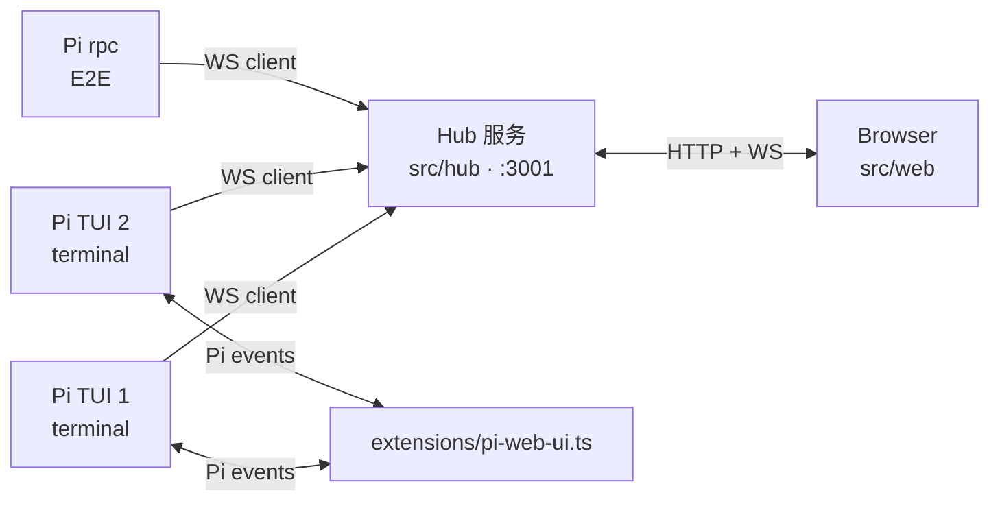

# AGENTS.md

## Policies & Mandatory Rules

### `latestCtx` — Never capture `ctx` in long-lived closures

The Pi extension runner **invalidates** `ExtensionContext` after session replacement, fork, switch, or reload. Any closure that captures a `ctx` parameter and uses it after one of those operations will throw:

> This extension ctx is stale after session replacement or reload. Do not use a captured pi or command ctx after ctx.newSession(), ctx.fork(), ctx.switchSession(), or ctx.reload().

**Rule**: `extensions/pi-web-ui.ts` uses a module-level `latestCtx` variable. Every Pi event callback updates it with the fresh `ctx`.

**All code that may run after a session lifecycle event** — WebSocket `close`/`error`/`connection` handlers, `setInterval` timers, async callbacks from external sources — must use `latestCtx`, never a captured `ctx` parameter.

The same stale-context rule applies to `latestExecuteCtx` (`ExtensionCommandContext`, captured via `/webui:connect`, adds `navigateTree()`, `fork()`, and other session-control methods).
After session replacement, any captured `ExtensionCommandContext` becomes stale and must be re-captured via `/webui:connect`.

### Extension output — `ctx.ui.setStatus` / `ctx.ui.notify` only

Per `docs/adr/0001-pi-extension-output-policy.md`: never write to `stdout`/`stderr` from extension code. Use `ctx.ui.setStatus(...)` for persistent state and `ctx.ui.notify(...)` for one-shot user messages. Use `latestCtx`, not a captured `ctx`.

### Event forwarding — thin transport

Per `docs/adr/0002-web-ui-extension-event-protocol.md`: the extension forwards events unchanged. Never interpret extension payloads into Pi Web UI product concepts inside the extension. The browser owns feature interpretation.

### Mandatory Skill Usage

#### `$webui-visual-check`

Run `$webui-visual-check` after UI, WebSocket-driven visible state, session sidebar, app header, Right Panel, mobile sheet, or chat input toolbar changes where DOM-only checks can miss visible regressions. Skip for docs-only changes unless the docs change this skill or visual validation requirements. This skill is visual validation, not E2E.

The skill drives a real browser via the `agent-browser` CLI (`npm install -g agent-browser`, then `agent-browser install` once). It does not depend on any host-specific built-in browser tool.

## Project Structure Guide

### Repo Structure & Important Files

```
.
├── docs/
│   ├── adr/                     # Architecture Decision Records (必读)
│   │   ├── 0001-pi-extension-output-policy.md          # Extension output rules (no stdout/stderr)
│   │   ├── 0002-web-ui-extension-event-protocol.md     # Web UI event forwarding protocol
│   │   ├── 0003-navigate-tree-via-captured-command-context.md # latestCtx vs latestExecuteCtx workaround
│   │   ├── 0004-web-ui-access-bind-address.md          # Server bind address policy
│   │   ├── 0005-intercepted-command-ui-lifecycle.md    # Intercepted command UI state handling
│   │   ├── 0006-project-scope-single-session-web-ui.md # Single-session scope definition (superseded by 0012)
│   │   ├── 0007-npm-publish-distribution-strategy.md   # npm publish + dist/ strategy
│   │   ├── 0008-unified-websocket-protocol.md          # WebSocket req/res/event protocol
│   │   ├── 0009-frontend-state-management-hybrid-zustand.md # Zustand + local state hybrid
│   │   ├── 0010-real-pi-web-ui-e2e.md                  # Real Pi agent Web UI E2E tests
│   │   ├── 0011-web-ui-visual-validation.md            # Browser screenshot visual validation
│   │   └── 0012-central-hub-connect-out-architecture.md # Hub service + extension connect-out (multi-session)
│   ├── prd/                     # Product Requirement Documents (功能设计)
│   │   ├── arch-mode-ui.md          # Architecture mode toggle UI
│   │   ├── tree-sidebar.md          # SUPERSEDED — conversation tree removed
│   │   ├── columns-layout.md        # Multi-column layout design
│   │   ├── branch-message.md        # SUPERSEDED — branch entry removed with tree
│   │   ├── left-sidebar.md          # Left sidebar design
│   │   ├── right-panel.md           # Tabbed right panel design (git-diff only; artifact tabs removed)
│   │   ├── workspace-artifacts.md   # REMOVED — artifacts feature deleted
│   │   └── workspace-status-float.md # REMOVED — float deleted; git status lives in the header
│   └── images/                  # Screenshots for README
├── extensions/
│   └── pi-web-ui.ts           # Main extension: connect-out client to the hub (events + commands)
├── src/
│   ├── hub/                   # Standalone hub service (compiled to dist-hub/, ADR 0012)
│   │   ├── cli.ts             # CLI entry (bin: pi-web-ui)
│   │   ├── server.ts          # HTTP static serving + /ws/extension + /ws WebSocket endpoints
│   │   ├── registry.ts        # Agent/browser registry, attach, relay with id rewriting, fan-out
│   │   └── history.ts         # Recent-session listing from ~/.pi/agent/sessions (deferred feature)
│   └── protocol/              # Shared protocol types for extension ↔ hub ↔ browser (ADR 0008/0012)
│       └── index.ts           # Envelope, agent identity, hub-level methods/events
├── e2e/                         # Real Pi agent E2E tests
│   ├── features/                # Playwright-BDD feature files
│   ├── steps/                   # Step definitions
│   ├── fixtures/                # Faux provider extension and response fixtures
│   └── harness/                 # pi --mode rpc process/session launcher
├── src/web/                     # React frontend source
│   ├── index.html               # Vite entry HTML
│   ├── index.css                # Global styles (Tailwind)
│   ├── src/
│   │   ├── main.tsx             # React entry point
│   │   ├── app.tsx              # Root layout + local UI state
│   │   ├── core/
│   │   │   ├── pi-client.ts     # WebSocket transport, reconnect, req/res queue
│   │   │   ├── ws.ts            # WebSocket URL helper
│   │   │   ├── types.ts         # TypeScript types for WebSocket protocol
│   │   │   ├── chat-conversion.ts # Converts raw events → UI message models
│   │   │   ├── format.ts        # Display formatting utilities
│   │   │   ├── tool-summary.ts  # Tool call summary rendering
│   │   │   ├── constants.ts     # Shared constants
│   │   │   └── store/           # Zustand slices + event dispatcher
│   │   └── components/
│   │       ├── pi-web-ui/       # Pi Web UI components
│   │       │   ├── chat-item-view.tsx    # Main chat message renderer
│   │       │   ├── conversation-sidebar.tsx     # Left sidebar (session list + search)
│   │       │   ├── command-palette.tsx   # Command palette
│   │       │   ├── model-picker.tsx
│   │       │   ├── settings-panel.tsx
│   │       │   ├── context-popover.tsx
│   │       │   ├── right-panel.tsx
│   │       │   ├── user-message-view.tsx # User message view
│   │       │   └── ...
│   ├── components/
│   │   ├── ai-elements/         # AI Elements components (conversation, message, tool, reasoning, etc.)
│   │   └── ui/                  # shadcn/ui primitives (button, dialog, input, etc.)
│   └── lib/
│       └── utils.ts             # shadcn/ui utility (cn helper)
├── public/                      # Static assets copied by Vite (icons, manifest, sw.js)
├── dist/                        # Vite build output (gitignored)
├── dist-hub/                    # Hub build output (gitignored)

├── MOBILE.md                    # Mobile access guide
├── RELEASING.md                 # npm publish and pi.dev verification checklist

├── package.json                 # npm package config + pi extension manifest + hub bin
├── tsconfig.json                # TypeScript config (src/web + src/protocol)
├── tsconfig.hub.json            # TypeScript config (src/hub + src/protocol, NodeNext → dist-hub)
├── tsconfig.extension.json      # TypeScript config (extensions/ + src/protocol, noEmit static check)
├── vite.config.ts               # Vite config (dev proxy to :3001, build to dist/)
├── biome.json                   # Biome formatter/linter config
└── justfile                     # just tasks (fmt, check)
```

### Architecture: Hub ↔ Extension ↔ Frontend (ADR 0012)



- **Hub (`src/hub/`)**: standalone service that serves the built frontend over HTTP, exposes `/ws/extension` (Pi extensions connect out) and `/ws` (browsers attach), routes req/res with id rewriting, and fans events out to attached browsers. History listing is implemented but the feature is deferred (ADR 0012).
- **Extension (`extensions/pi-web-ui.ts`)**: WS **client** to the hub. Subscribes to Pi events via `pi.on(...)` and forwards them unchanged; executes commands relayed by the hub via `latestCtx`/`latestExecuteCtx`. Connects via `/webui:connect [url]` or `PI_WEB_UI_HUB`.
- **Frontend (`src/web/`)**: React + Vite + Tailwind. `PiClient` connects to the hub WebSocket, `event-dispatch.ts` routes raw events into Zustand slices (`hub-slice.ts` tracks live agents and attach state), and React components render store state.
- **Dev proxy**: `vite dev` on `:4444` proxies `/api` → `:3001` and `/ws` → `ws://localhost:3001` (the hub).

#### Event envelope

All WebSocket messages use the same envelope on both hops (browser ↔ hub, hub ↔ extension):

```json
{ "type": "event", "event": "<event-name>", "payload": { "...": "..." } }
```

Pi core events carry their native fields inside `payload`. Hub-level events (`hub:sessions`, `hub:agent_gone`) originate from the hub and are never relayed to agents. Extension-bus events keep their source payload nested under `payload` when needed to avoid field collisions. Command routing is attach-based (ADR 0012): the hub relays each browser command to the agent the browser is currently attached to; only the `attach` request itself carries an `agentId` param, and `list_sessions`/`list_history`/`health` are handled by the hub directly.

#### State snapshot on attach

When a browser attaches, the hub replays the registered agent's latest state: the extension's `buildStateSnapshot(latestCtx)` sends full session state (messages, model, session info, tool calls) to the hub on request, and the hub relays it to the browser. After that, incremental events keep the UI in sync. On session replacement (`session_start`), the extension sends `session_update` and the hub updates the registry entry **in place** — attached browsers keep their view.

## Operation Guide

### Development Workflow

#### Frontend development

Start the hub (serves the built frontend + WebSocket endpoints) in one terminal, and Pi with the extension in another:

```bash
npm run build:web   # build the frontend into dist/
npm run hub         # build:hub + start the hub on 127.0.0.1:3001
```

Then connect the Pi session with `/webui:connect` (or `PI_WEB_UI_HUB=ws://127.0.0.1:3001/ws/extension pi`).

For live frontend editing without rebuilding, run the hub and the Vite dev server side by side:

```bash
just dev-hub   # = npm run dev: concurrently runs `npm run hub` + `npm run dev:web`
```

Open `http://localhost:4444`. Vite serves the React UI and proxies `/api` and `/ws` to the hub. Both sides resolve the hub port from `PI_WEB_UI_HUB_PORT` (default 3001), so the proxy never drifts from the hub. Ctrl-C stops both processes. If the hub is already running elsewhere, `npm run dev:web` alone also works. The dev proxy makes `wsUrl()` work unchanged in dev.

#### Build for production

```bash
npm run build:web   # outputs dist/ (frontend)
npm run build:hub   # outputs dist-hub/ (hub, also compiled by prepack)
```

Start the hub from the repository:

```bash
npm run hub         # or: node dist-hub/hub/cli.js
```

Start Pi with the extension connected to it:

```bash
PI_WEB_UI_HUB=ws://127.0.0.1:3001/ws/extension pi
```

or inside Pi: `/webui:connect` (uses `PI_WEB_UI_HUB`, the `hub` key in `~/.pi/agent/settings.json`, or `ws://127.0.0.1:3001/ws/extension` by default).

### Testing & Checks

Testing has three layers:

| Layer | Purpose | Includes Pi agent? | Primary tool |
|-------|---------|--------------------|--------------|
| Check | Fast local static/build validation | No | `just check`, `npm run build:web` |
| E2E | Validate the real Pi Web UI product path | Yes | Playwright-BDD + `pi --mode rpc` + faux provider |
| Visual validation | Inspect rendered UI for visible layout defects | Optional | Browser screenshots via `$webui-visual-check` |

E2E means the test includes the real Pi product path:

```text
Playwright Browser
  -> Hub static UI + /ws (src/hub, dist needed)
  -> pi --mode rpc (loads extensions/pi-web-ui.ts, connects via PI_WEB_UI_HUB)
  -> Pi agent session
  -> faux LLM provider
  -> real tools / real temp workspace / real git
```

E2E rules:

- Put E2E tests under `e2e/`.
- Use Playwright-BDD feature files for product-level flows.
- Start a real `pi --mode rpc` process for each scenario, plus a hub process.
- Load the local `extensions/pi-web-ui.ts` extension normally; the harness injects `/webui:connect` over rpc stdin to connect it to the hub (`PI_WEB_UI_HUB` supplies the default target only). Connection is manual by design — the extension never connects on its own.
- Use built `dist` assets served by the hub in CI.
- Use a faux LLM provider only to make model responses deterministic.
- Use real Pi `write` / `edit` tools when testing file-producing flows.
- Use real git repositories in temp workspaces when testing git status or diff.
- Do not mock `/ws`, set React state directly, or call component props in E2E.

Run the real Pi E2E suite with:

```bash
npm run e2e
```

Regenerate Playwright tests from feature files without running the browser with:

```bash
npm run e2e:gen
```

GitHub Actions runs E2E on every PR after `npm run build:web`. Local default checks do not run E2E unless the developer explicitly invokes the E2E command or is changing E2E harness/tests.

**Local test time budget**: do not run test commands expected to take longer than 30 seconds locally unless they are necessary for the change at hand (for example, running `npm run e2e` when changing the E2E harness, fixtures, or product flows it covers). Prefer fast targeted checks — `just check`, `npx tsc --noEmit`, single-feature Playwright runs (`npx playwright test -c e2e/playwright.config.ts <feature-name>`) — and let CI run the long suites.

Visual validation checks what the user can actually see. Run `$webui-visual-check` after UI, WebSocket-driven visible state, session sidebar, app header, Right Panel, mobile sheet, or chat input toolbar changes where DOM-only checks can miss visual regressions. It may inspect a real E2E-created state, a real local Pi session, or a future frontend visual harness. A frontend-only visual harness is not E2E. The skill uses the `agent-browser` CLI for screenshots.

Run before committing:

```bash
just check
```

This runs `npx tsc --noEmit` (web + protocol), `npx tsc --noEmit -p tsconfig.hub.json` (hub), `npx tsc --noEmit -p tsconfig.extension.json` (extension), then `npm run check` (`biome check .`). To format only:

```bash
just fmt
```

To lint only:

```bash
npm run lint
```

### Publishing

For npm releases, read and follow `RELEASING.md` before changing package release metadata or running publish commands.

```bash
npm pack --dry-run --json
```

### Key Files to Update Together

When adding a new WebSocket event type from the extension to the browser:

1. `extensions/pi-web-ui.ts` — emit the event (thin transport)
2. `src/protocol/index.ts` — add the event name constant/type if it is a hub-level event
3. `src/web/src/core/types.ts` — add the browser-side payload type
4. `src/web/src/core/store/event-dispatch.ts` — route the event to a store action
5. Relevant `src/web/src/core/store/*-slice.ts` file — update domain state
6. `src/web/src/core/chat-conversion.ts` — add conversion logic if it affects chat display
7. Corresponding React component in `src/web/src/components/pi-web-ui/`

The hub relays events as-is; only touch `src/hub/registry.ts`/`server.ts` when the event needs hub-level semantics (e.g. caching for attach replay, or a new hub-scoped event).

When adding a new browser → extension command:

1. `src/protocol/index.ts` — add the method name constant (agent methods need no hub changes; only hub-scoped methods join `HUB_METHODS`)
2. `extensions/pi-web-ui.ts` — add the case to the command handler (use `latestCtx`)
3. `src/web/src/core/types.ts` — add the request/response type
4. `src/web/src/core/store/*-slice.ts` — add an intent-level store action that calls `send(...)`
5. React components — call the store action instead of invoking transport directly

When changing the Right Panel or header git status:

1. `docs/prd/right-panel.md` — update tab, toggle, and panel lifecycle behavior
2. `docs/adr/0008-unified-websocket-protocol.md` — update WebSocket methods if data access changes
3. `src/web/src/core/store/workspace-slice.ts` and `src/web/src/core/store/right-panel-slice.ts` — update shared state and tab lifecycle
4. `src/web/src/components/pi-web-ui/app-header.tsx` and `right-panel.tsx` — keep UI behavior aligned with the PRDs

When changing real Pi E2E behavior:

1. `docs/adr/0010-real-pi-web-ui-e2e.md` — update process, fixtures, or scope decisions
2. `e2e/features/*.feature` — update product-level scenarios
3. `e2e/steps/*.ts` — update Playwright-BDD steps
4. `e2e/harness/*.ts` and `e2e/fixtures/**` — update Pi launch, temp workspace, or faux provider behavior
5. `.github/workflows/ci.yml` and `package.json` — keep CI and local commands aligned

### Reference

- Pi RPC docs: `/opt/homebrew/lib/node_modules/@mariozechner/pi-coding-agent/docs/rpc.md`
- Pi SDK docs: `/opt/homebrew/lib/node_modules/@mariozechner/pi-coding-agent/docs/sdk.md`
- Pi JSON mode: `/opt/homebrew/lib/node_modules/@mariozechner/pi-coding-agent/docs/json.md`
- Pi session docs: `/opt/homebrew/lib/node_modules/@mariozechner/pi-coding-agent/docs/session.md`
