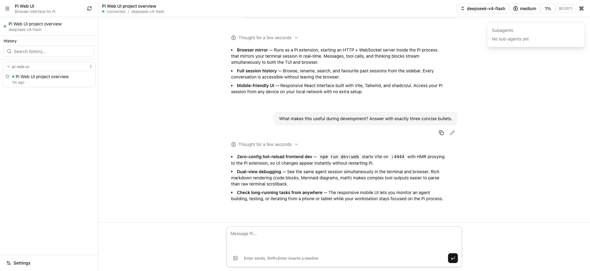
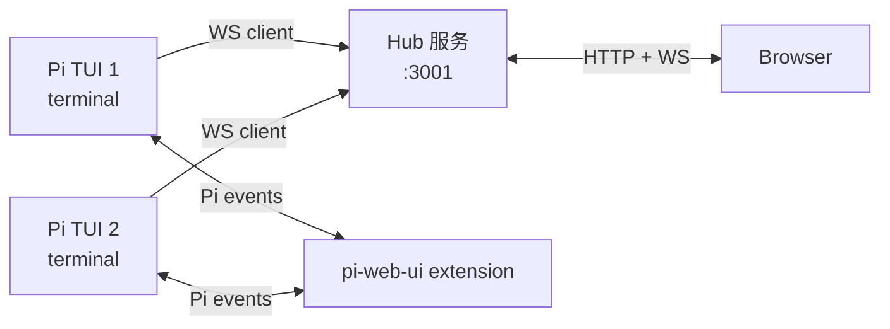

# Pi Web UI

A web UI for [Pi](https://github.com/badlogic/pi-mono) coding agent. A standalone **hub** service serves the browser UI and aggregates **one or many Pi sessions** that connect out to it — view and control every agent from the browser.

> **Forked from [deflating/tau](https://github.com/deflating/tau).** Thanks to the original author for building the foundation.
> Renamed to pi-web-ui, then re-architected from a single in-process server to a hub + connect-out extension model (ADR 0012).

## What it does

Run the hub once, then run any number of Pi agents (TUI tabs, `pi --mode rpc`, CI agents) and connect them to the same hub. Open the browser and you get a unified console: pick an agent from the session list, watch it stream in real time, and drive it with prompts, model changes, git/file navigation, and more.



- **Real-time streaming** — messages, tool calls, and thinking blocks
- **Multi-session** — one hub aggregates every connected Pi process; the browser attaches to one at a time
- **Session continuity** — `/new`, fork, or `switchSession` update the agent's identity in place; the browser keeps its view with no reattach
- **React UI** — Vite, Tailwind, shadcn/ui, AI Elements
- **Markdown rendering** — Streamdown for code blocks, math, Mermaid
- **Workspace tools** — git status/diff, file browsing, artifact preview (executed on the Pi side, in the agent's own workspace)
- **No port conflicts** — a single hub port; extensions are outbound WebSocket clients

## Install

Install from GitHub:

```bash
pi install git:github.com/kkkiio/pi-web-ui
```

Or from npm:

```bash
pi install npm:@kkkiio/pi-web-ui
```

## Usage

1. **Start the hub** (once, anywhere reachable by your agents and browser):

   ```bash
   npx pi-web-ui
   # or from the repository: npm run hub
   ```

   The hub serves the web UI and listens on `ws://127.0.0.1:3001/ws/extension` for agents and `ws://127.0.0.1:3001/ws` for browsers.

2. **Run your Pi agent** and connect it to the hub:

   ```bash
   PI_WEB_UI_HUB=ws://127.0.0.1:3001/ws/extension pi
   ```

   or inside Pi, type `/webui:connect` (uses `PI_WEB_UI_HUB`, the `hub` key in `~/.pi/agent/settings.json`, or the default `ws://127.0.0.1:3001/ws/extension`).

3. **Open the browser** at `http://127.0.0.1:3001` — pick your agent from the session list and interact.

Repeat step 2 for every agent you want to manage. The TUI and the browser control the same session; type in either place, both stay in sync. Disconnect with `/webui:disconnect`; the TUI is unaffected if the hub is down (the extension reconnects with backoff).

## Features

### Chat
- Streaming text and thinking/reasoning blocks
- Tool call display with expand/collapse
- Image attachments with paste, drop, and preview
- Follow-up messages while the agent is streaming

### Model & Thinking
- Current model label and searchable model picker
- Thinking level cycle button
- Context-window visualization and compact suggestion

### Sessions
- Live agent list (every Pi process connected to the hub)
- Attach/detach per browser; agent events fan out to every attached browser
- Auto-attach to the most recent agent when the page loads

### Workspace
- Git status + diff summary in a floating indicator and the right panel
- File browser and artifact preview for the attached agent's workspace
- Markdown artifacts recovered from tool calls and session entries

### Commands & Settings
- Command palette: compact, export HTML, session stats, tool toggle
- Light, dark, and system theme modes

## Configuration

Hub environment variables (set before starting the hub):

| Variable | Default | Description |
|----------|---------|-------------|
| `PI_WEB_UI_PORT` | `3001` | Hub HTTP + WebSocket port |
| `PI_WEB_UI_HOST` | `127.0.0.1` | Bind address |
| `PI_WEB_UI_STATIC_DIR` | *(bundled)* | Override static files path (the built frontend) |

Extension environment variables (set before starting Pi):

| Variable | Description |
|----------|-------------|
| `PI_WEB_UI_HUB` | Hub WebSocket URL for the agent to connect out to (e.g. `ws://127.0.0.1:3001/ws/extension`) |
| `PI_WEB_UI_DISABLED` | Set to `1` to disable the extension |
| `PI_CODING_AGENT_DIR` | Override Pi config directory (default `~/.pi/agent`) |

Or in `~/.pi/agent/settings.json`:

```json
{
  "pi-web-ui": {
    "hub": "ws://127.0.0.1:3001/ws/extension",
    "disabled": false
  }
}
```

### Commands

```
/webui:connect [url]      Connect this Pi session to a hub (default from env/settings/127.0.0.1:3001)
/webui:disconnect         Disconnect from the hub
```

## Security

The hub binds to `127.0.0.1` by default — accessible only from your local machine. For remote access from your phone, run the hub on a machine reachable from the internet and put a tunnel in front of it (e.g. Cloudflare Tunnel + Access), relying on the tunnel's access control — there is no built-in authentication.

## How it works

Two pieces ship in this package:

- **Hub** (`src/hub/`) — a standalone Node service. Serves the built frontend over HTTP, accepts outbound connections from Pi extensions on `/ws/extension`, accepts browsers on `/ws`, maintains an agent registry, routes requests with id rewriting, and fans events out to attached browsers.
- **Extension** (`extensions/pi-web-ui.ts`) — loaded inside each Pi process. Subscribes to Pi events and forwards them unchanged (thin transport, ADR 0002); executes commands relayed by the hub via the Pi extension API (`latestCtx`/`latestExecuteCtx`). File/git commands run on the Pi side, in the agent's own workspace.



One protocol, one envelope (`req`/`res`/`event`) on both hops (browser ↔ hub ↔ extension); the hub rewrites request ids so browser namespaces never collide (ADR 0008).

## Development

```bash
git clone https://github.com/kkkiio/pi-web-ui.git
cd pi-web-ui
npm install
npm run build:web      # frontend → dist/
npm run hub            # hub build + start on 127.0.0.1:3001
```

In another terminal, connect an agent:

```bash
PI_WEB_UI_HUB=ws://127.0.0.1:3001/ws/extension pi
```

For frontend development without rebuilding:

```bash
npm run dev:web
```

Open `http://localhost:4444`; Vite serves the React UI and proxies `/api` and `/ws` to the hub on `localhost:3001`.

## License

MIT