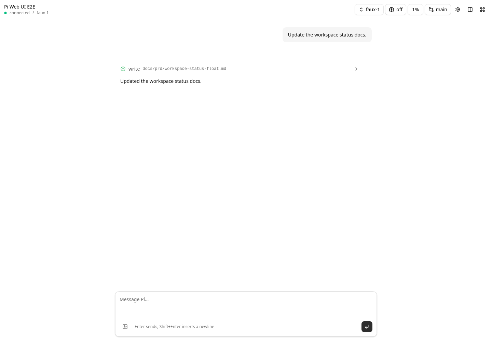
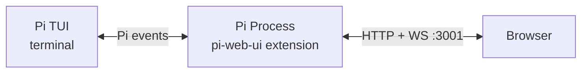

# Pi Web UI



An **interactive agent UI** for the [Pi](https://pi.dev/) coding agent.

> Renamed to pi-web-ui with significant changes including single-session scope, removed auth, redesigned sidebar, and an interactive agent steering focus.

## Install

Install from GitHub:

```bash
pi install git:github.com/kkkiio/pi-web-ui
```

Or from npm:

```bash
pi install npm:@kkkiio/pi-web-ui
```

## Usage

1. Start Pi in terminal
2. Enter `/webui` to start the server and open the browser.

Use `/webui-stop` to stop the server.

See [docs/configuration.md](docs/configuration.md) for environment variables, `settings.json`, and remote access setup.

## Features

- [x] Real-time bidirectional sync with Pi TUI
- [x] Model picker, thinking level control, and context usage indicator
- [x] Git diff panel
- [x] Edit Message (inline rollback & resend; enabled by `/webui`)
- [x] Add to Chat
- [ ] Git Diff Comment
- [ ] BTW / Ask in Side Chat
- [x] AskUserQuestion
- [ ] Generative UI

## How it works

Pi Web UI is a [Pi extension](https://github.com/badlogic/pi-mono#extensions). Running `/webui` starts an HTTP + WebSocket server inside the Pi process. The extension forwards Pi events to the browser, and browser commands execute through Pi's extension API.


