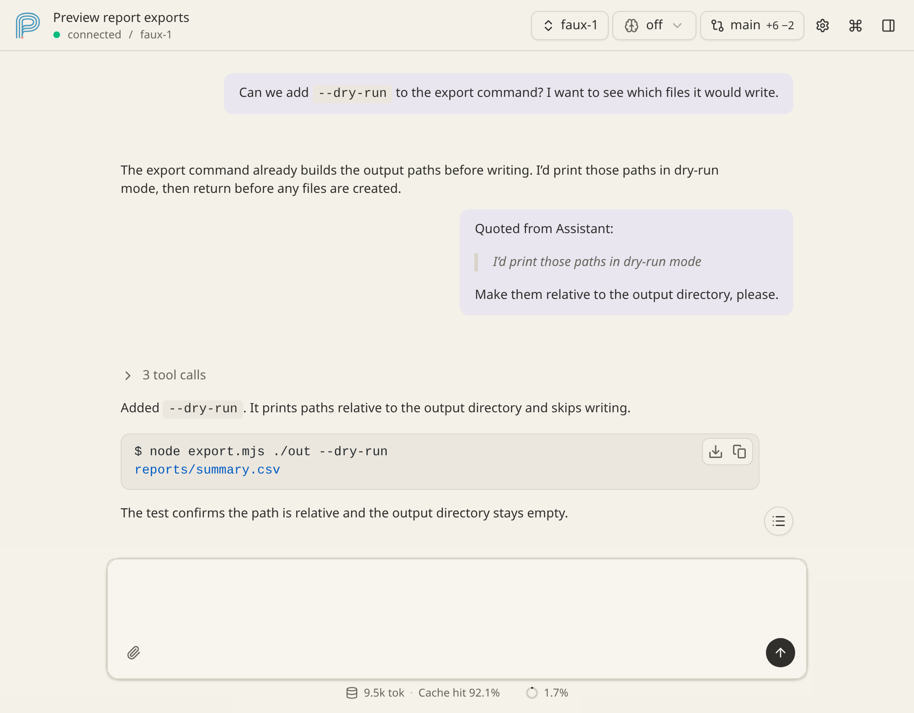
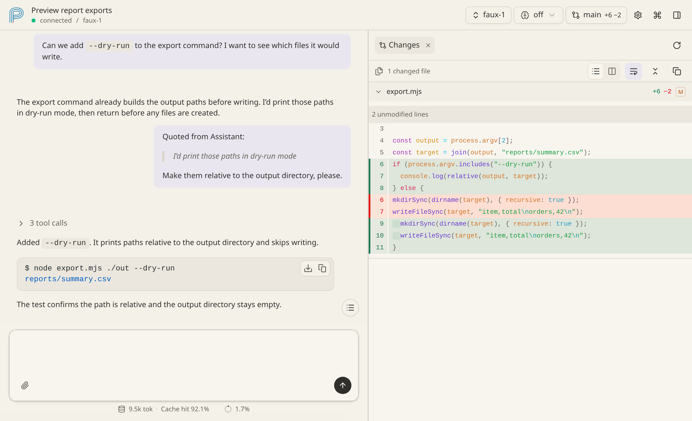
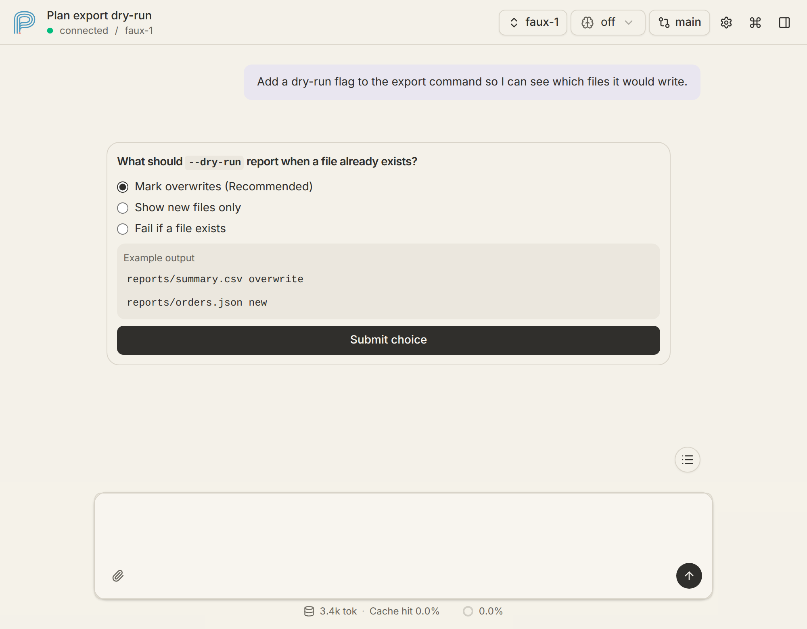
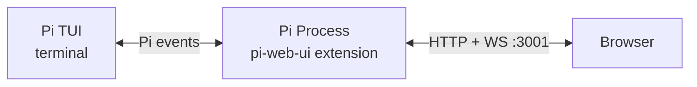

# Pi Web UI

[](https://coveralls.io/github/kkkiio/pi-web-ui?branch=main)



An **interactive agent UI** for the [Pi](https://pi.dev/) coding agent.

## Install

Install from GitHub:

```bash
pi install git:github.com/kkkiio/pi-web-ui
```

Or from npm:

```bash
pi install npm:@kkkiio/pi-web-ui
```

## Usage

1. Start Pi in terminal
2. Enter `/webui` to start the server and open the browser.

Use `/webui-stop` to stop the server.

See [docs/configuration.md](docs/configuration.md) for environment variables, `settings.json`, and remote access setup.

## Features

- [x] Real-time bidirectional sync with Pi TUI
- [x] Git Diff Panel
- [x] Edit Message (inline rollback & resend; enabled by `/webui`)
- [x] Add to Chat
- [x] Git Diff Comment
- [x] Generative UI, including interactive clarification cards
- [ ] BTW / Ask in Side Chat

### Git Diff

Review what the agent changed on disk without leaving the conversation.



### Interactive clarification

Pi can pause to ask how a change should work. Preview the options and submit a choice from the card, or answer in the chat input.



## How it works

Pi Web UI is a [Pi extension](https://github.com/badlogic/pi-mono#extensions). Running `/webui` starts an HTTP + WebSocket server inside the Pi process. The extension forwards Pi events to the browser, and browser commands execute through Pi's extension API.


