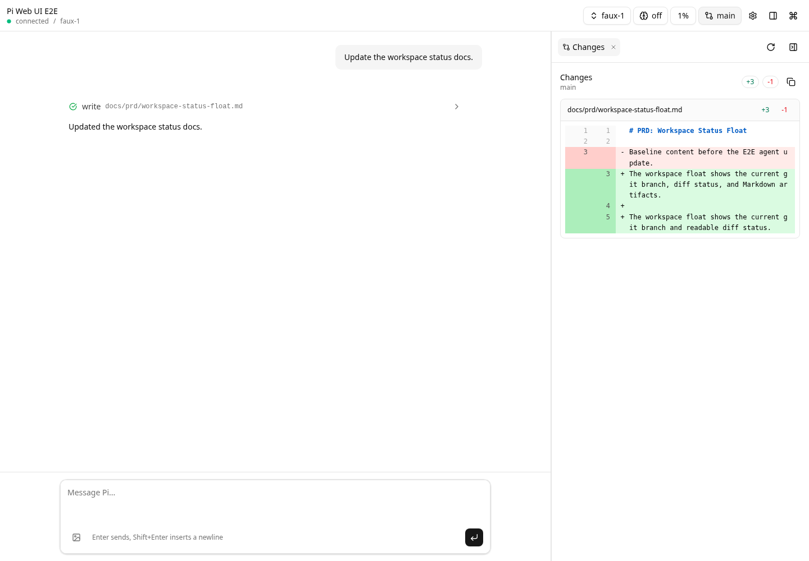
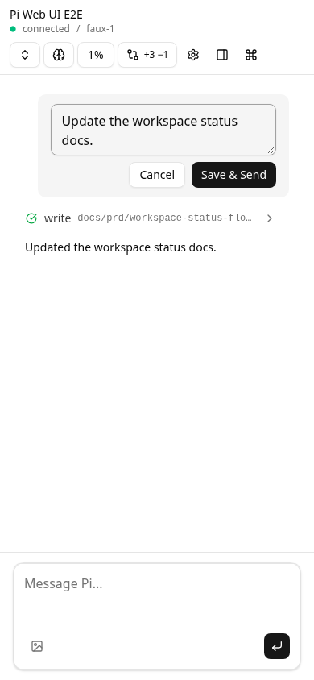
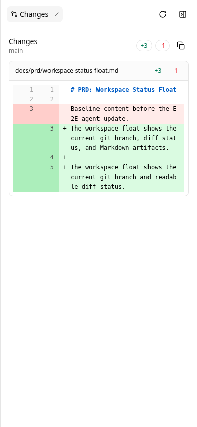

# Pi compatibility

Pi Web UI targets `@earendil-works/pi-coding-agent` 1.5.2 through the 1.x series.
Node.js 22.19.0 or newer is required, matching the upstream runtime requirement.
The lockfile records the tested version. Older 0.x versions are no longer supported.

## API audit

- Extension event callbacks refresh `latestCtx`; asynchronous WebSocket handlers use
  the latest context. Session replacement clears the captured command context and
  disables editing until `/webui` is run again.
- Pi 1.5's public `ExtensionCommandContext.navigateTree()` returns a cancellation
  flag. The browser owns its edit draft and does not depend on the internal
  `editorText` return field. Navigating to a user message rewinds before that
  message, preserving the previous branch in the session file.
- Save & Send waits for successful navigation and an authoritative branch snapshot
  before sending the edited text. A failed or cancelled navigation sends no prompt.
  This changes conversation history, not files already modified by tools.
- Model selection uses the SDK's model registry types; thinking levels are
  validated before crossing the SDK boundary.
- Native message/tool events are forwarded unchanged in the WebSocket event
  envelope. UI interpretation remains in the browser.
- The deterministic E2E provider uses Pi 1.5's `fauxProvider()` and registers the
  provider object, replacing the removed global `registerFauxProvider()` API.

`npm run check:extension` checks the server against the installed SDK in addition
to the frontend TypeScript check. CI runs both checks and the real Pi E2E suite.

## Verification

The E2E suite starts the installed Pi CLI in RPC mode, loads the extension normally,
and uses a deterministic provider with real tools and a temporary git workspace.
It covers prompt streaming, tool success/failure, refresh recovery, Header/Changes,
mobile sheet behavior, editing capability gating, and rollback/resend with a
preserved composer draft. `/webui` is invoked through the real RPC command path.

For a preinstalled Chromium in restricted environments, set
`PLAYWRIGHT_CHROMIUM_EXECUTABLE_PATH` when running `npm run e2e`.

## Visual validation

Inspected the real Pi session at a loopback URL with Chromium at 1440×1000
and 390×844. Screenshots show a centered single-column chat, a resizable Changes
panel on desktop, a full-width mobile Changes sheet, and the inline editor with
Cancel / Save & Send. No overlapping controls or horizontal page overflow were
visible. The managed Browser tool failed during sandbox startup, so screenshots
were captured with Playwright Chromium and inspected as images.

